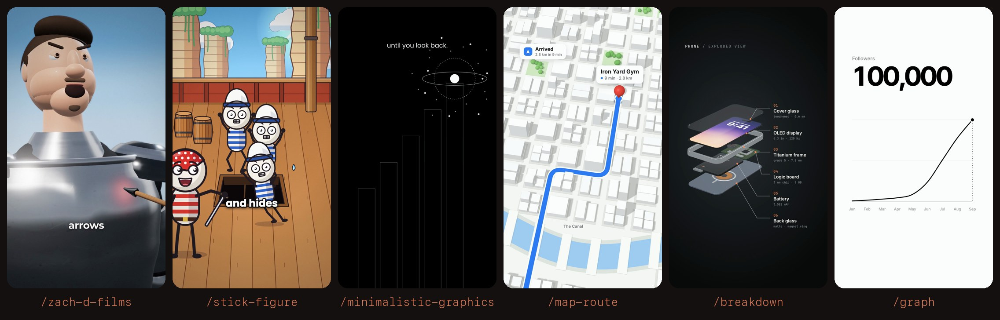
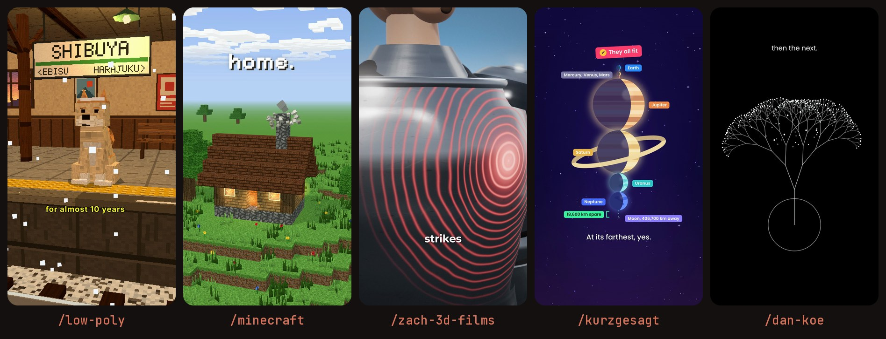

# Claude animation skills

Skills for Claude Code that make animations for reels, with no footage needed. You type `/map-route home to the gym, 2.8 km` and Claude writes the spec, renders the animation on your own computer and checks it against Instagram's safe area.



| Skill | What it makes | Try it with |
|---|---|---|
| `/zach-d-films` | **A 3D cartoon "what if" explainer.** Cartoon people, props and effects built in three.js, slow-motion impacts, a red force ripple and captions timed to your voiceover. Comes with a finished 29 s example to build from. | `Could ancient armour stop an arrow?` |
| `/stick-figure` | **A stick-figure explainer reel.** A bright cartoon world, stick people with big faces, whip transitions, 1 to 2 word captions, and music and sound effects made in code. Comes with a finished 37 s example. | `Why did pirates wear eye patches?` |
| `/minimalistic-graphics` | **Black-and-white line art.** Hairline steps rise, one white dot hops up them and gets an orbit at the top, with one quiet line of text. | `Every step feels small until you look back` |
| `/map-route` | **A 3D map route.** A white city, a route that draws itself while the camera follows, a pin drop, an ETA that counts down and a destination card. | `Home to the gym, 2.8 km` |
| `/breakdown` | **A 3D exploded view.** A phone comes apart layer by layer, and every part gets a leader line and a label. | `My phone, every part labelled` |
| `/graph` | **A minimal line graph.** A smooth line draws itself, and one big number counts up with its tip. Black on white, or white on black. | `0 to 100K followers in 9 months` |

See them moving: **[novitckii.com/resources/animation-skills](https://novitckii.com/resources/animation-skills/)**

### 5 animation styles (new)



| Skill | What it makes | Try it with |
|---|---|---|
| `/low-poly` | **PS1-era low-poly 3D.** Chunky pixels, wobbly vertices, dithering and small yellow captions. The built-in scene: a dog waits on a station platform, a train comes and goes, and he is still there in the snow. | `The dog who waited at the station for 10 years` |
| `/minecraft` | **A blocky voxel build.** A cottage builds itself block by block on a grassy hill, the chimney slams in and the windows light up. Every texture is drawn in code. | `Build a tiny cottage block by block` |
| `/zach-3d-films` | **The 3D cartoon explainer.** The same engine as `/zach-d-films`, under the name from the reel. | `Could ancient armour stop an arrow?` |
| `/kurzgesagt` | **Flat-vector space.** Glowing planets with a dark crescent, twinkling stars and bright label tags. The built-in scene stacks every planet, to scale, between Earth and the Moon. | `Do all the planets fit between Earth and the Moon?` |
| `/dan-koe` | **Black-and-white line art.** One dot grows into a hairline tree that splits in two at every step, and the tips light up. | `One choice, then the next` |

See them moving: **[novitckii.com/resources/animation-styles](https://novitckii.com/resources/animation-styles/)**

### Cartoon 3D story shorts ([claude-animated-shorts](https://github.com/mromidev/claude-animated-shorts))

| Skill | What it makes | Try it with |
|---|---|---|
| `/cartoon-3d-short` | **A 55–70 s vertical cartoon story short.** Flat 2D bean-head characters with ink outlines in a painted 3D world, lens blur, gliding cameras, voice narration, synthesized SFX and a march-style score, rendered with three.js inside Remotion. Includes the full 67 s Broughton bridge template, style bible, measured look reports and reference frames. | `Make a cartoon 3D short about the 1831 Broughton bridge` |

### Hand-drawn 2D storybook & action animation ([claude-animation-skill](https://github.com/buildwithhanif/claude-animation-skill))

| Skill | What it makes | Try it with |
|---|---|---|
| `/claude-animation` | **Frame-exact hand-drawn 2D animation in JavaScript.** Paper grain, hatching, brush ink, watercolour washes, faceted low-poly landscapes, video-game hit-stop/FX, articulated rigs (ant, chibi, bean, critter, bug) and synthesised ukulele, chiptune, ambient and SFX audio — rendered with `@napi-rs/canvas` and ffmpeg (no browser or GPU). Includes 4 worked example films (`examples/`). | `Animate a 30-second storybook short about a leafcutter ant colony` |

### HyperFrames video skills ([hyperframes](https://github.com/heygen-com/hyperframes))

| Skill | What it makes | Try it with |
|---|---|---|
| `/hyperframes` | **Read first for any HyperFrames video.** HTML-to-MP4 render contract, workflow and references for launch films, explainers, music videos, charts, maps, vertical clips, title cards, captions and overlays. | `Create a 10-second product intro with a fade-in title and subtle music` |
| `/hyperframes-cli` | **The HyperFrames CLI by job.** Scaffold, lint, check frames, edit timelines, preview, render locally or in the cloud, share and recover from render failures. | `Scaffold a new vertical HyperFrames project and preview it` |
| `/hyperframes-registry` | **~450 editable blocks and components.** Transitions, overlays, titles, kinetic type, captions, charts, map overlays, 3D and camera moves installed as editable source via `hyperframes catalog` and `add`. | `Find a kinetic caption and CRT scanline overlay in the registry` |
| `/media-use` | **Media, audio and grading for video.** Music, SFX, images, icons, logos, voiceover, avatars, generated video, transcripts, cutouts, colour grades/LUTs and audio ducking with HeyGen or free local tools. | `Add background music ducked under the voiceover and transcribe it` |
| `/reverse-any-video` | **Frame-accurate video rebuilds (HyperFrames Pro).** Rebuild a video file as an editable HyperFrames project, checked frame by frame against the original. | `Reverse intro.mp4 into an editable HyperFrames project` |
| `/style-sampling` | **Proven series templates (HyperFrames Pro).** Make a new episode on your topic in Collage Explainer, Finance Explainer, Animated Science Explainer, 3D Brand Explainer or 3D True Crime style. | `Make an Animated Science Explainer episode on how submarines dive` |
| `/figma` | **Figma to HyperFrames.** Import Figma frames, assets, brand tokens, components, reconstructed storyboard motion and shaders into a video (`FIGMA_TOKEN` required). | `Bring this Figma frame into my intro video` |
| `/slideshow` | **Interactive live decks.** Slides, fragment reveals, branching hotspots and presenter mode with speaker notes served by `hyperframes present`. | `Build a 6-slide launch deck with fragment reveals and speaker notes` |
| `/remotion-to-hyperframes` | **Port existing video code to HyperFrames.** Convert Remotion, Motion Canvas, Lottie, three.js, p5.js, canvas or rendered clips into HyperFrames and verify frame by frame. | `Port my Remotion composition to HyperFrames` |

## Install

You need macOS or Linux with **ffmpeg**, **Node.js 18+** (**Node.js 20+** for `/claude-animation`, **Node.js 22+** for the `/hyperframes` skill suite) and **Python 3.9+**. `/cartoon-3d-short` also needs a [Remotion](https://www.remotion.dev/) project with `@remotion/three` (plus `numpy`, `scipy` and `Pillow` for its audio and QA helpers).

```bash
brew install ffmpeg node        # if you don't have them
git clone https://github.com/artemnovitckii/claude-animation-skills.git ~/claude-animation-skills
cd ~/claude-animation-skills && ./install.sh
```

`install.sh` links every skill into `~/.claude/skills/` (so they show up as `/graph`, `/map-route` and so on) and runs the one-time setup. The setup installs three.js and Playwright into `kit/node_modules`, fetches GSAP and warms up HyperFrames.

`/stick-figure` and `/zach-d-films` also need a free voice and word timings. They run on your computer, with no API key, and need about 1 GB of models, downloaded once:

```bash
./install.sh --voice
```

To update later, run `git pull && ./install.sh`.

**It's also packaged as a Claude Code plugin.** Run these inside Claude Code:
```
/plugin marketplace add artemnovitckii/claude-animation-skills
/plugin install animation-skills@claude-animation-skills
```
Plugin skills are namespaced (`/animation-skills:graph`). The git clone above is the route tested end to end.

## Use

Open Claude Code anywhere and ask:

```
/graph 0 to 100K followers in 9 months: 1.2K, 2.1K, 3.4K, 5K, 9K, 24K, 51K, 78K, 100K
/map-route home to the gym, 2.8 km, 9 minutes
/minimalistic-graphics every step feels small until you look back
/breakdown my phone, label it like a joke
/stick-figure why did pirates wear eye patches?
/zach-d-films could ancient armour stop an arrow? (my voiceover is ~/Downloads/vo.m4a)
/low-poly the dog who waited at the station for 10 years
/minecraft build a tiny cottage block by block
/kurzgesagt do all the planets fit between Earth and the Moon?
/dan-koe one choice, then the next
/cartoon-3d-short make a cartoon 3D story short about the 1831 Broughton bridge
/claude-animation animate a 30-second storybook short about a leafcutter ant colony
/hyperframes create a 10-second product intro with a fade-in title and subtle music
```

**The quick ones** (`/graph`, `/minimalistic-graphics`, `/map-route`, `/breakdown`, `/dan-koe`, `/kurzgesagt`, `/low-poly`, `/minecraft`) work from a small JSON spec. Claude writes `name.graph.json`, runs the skill's `build.py`, and you get `name.graph.mp4` (1080x1920, 30 fps) plus `name.graph.sheet.jpg`, a contact sheet with Instagram's safe area marked. The 2D ones render in about 10 seconds, the 3D ones in about 1.5 minutes.

**The story and explainer engines** (`/stick-figure`, `/zach-d-films` / `/zach-3d-films`, `/cartoon-3d-short`, `/claude-animation`) build full animated reels and shorts. Claude starts from the bundled templates and example films, writes the beat sheet or script with you, records or generates voice/SFX/music, draws and rigs the scenes in code, checks contact sheets and strips, and renders. Plan on a working session, not one command.

**The HyperFrames suite** (`/hyperframes`, `/hyperframes-cli`, `/hyperframes-registry`, `/media-use`, `/reverse-any-video`, `/style-sampling`, `/figma`, `/slideshow`, `/remotion-to-hyperframes`) handles open-ended HTML-to-video authoring: compositions, ~450 reusable registry blocks/components, media/audio/grading workflows, Figma imports, live slideshows, video reverse-engineering and porting from Remotion or other runtimes.

## How it's built

```
skills/<name>/SKILL.md          what Claude follows: steps, the spec, taste rules
skills/<name>/build.py          spec.json -> template.html -> HyperFrames -> mp4   (all the quick skills)
skills/<name>/template.html     the animation (GSAP, or three.js for the 3D ones)
skills/stick-figure/engine/     canvas engine, voice + timing tools, make.sh, and the pirate reel as the template
skills/zach-d-films/engine/     three.js engine (people, props, effects, renderer) and the armour short as the example
skills/cartoon-3d-short/        Remotion + three.js bridge template, procedural SFX/music, QA helpers and style bible
skills/claude-animation/        @napi-rs/canvas 2D drawing/rig/FX library, synth audio scripts and 4 example films
skills/hyperframes*/ + friends  official HyperFrames skills, references, media/audio helpers and CLI launcher
kit/anim.py                     shared: fill a template, render, snapshots, contact sheet
kit/words.py                    word timings for a voiceover (Parakeet, on your computer)
kit/setup.sh                    one-time setup
```

To add a quick skill, copy a folder like `skills/graph`, change `template.html` (read the spec from `const SPEC = __SPEC__`) and its `DEFAULTS` in `build.py`, then run `./install.sh` again.

## Credits

- [HyperFrames](https://github.com/heygen-com/hyperframes) by HeyGen renders the quick skills and supplies `/hyperframes`, `/hyperframes-cli`, `/hyperframes-registry`, `/media-use`, `/reverse-any-video`, `/style-sampling`, `/figma`, `/slideshow` and `/remotion-to-hyperframes` (Apache-2.0, see `skills/hyperframes/LICENSE`).
- [Claude Animated Shorts](https://github.com/mromidev/claude-animated-shorts) by Mr omi supplies `/cartoon-3d-short` (MIT, see `skills/cartoon-3d-short/LICENSE`; reference frames for style study only).
- [Claude Animation](https://github.com/buildwithhanif/claude-animation-skill) by Hanif (`@hanifproduktif`) supplies `/claude-animation` (MIT, see `skills/claude-animation/LICENSE`).
- [three.js](https://threejs.org) draws the 3D, [GSAP](https://gsap.com) drives the 2D animation and [Playwright](https://playwright.dev) runs the engines' headless Chrome. They are installed at setup, not included here.
- The free voice is [Kokoro](https://github.com/thewh1teagle/kokoro-onnx) and the word timings come from NVIDIA's Parakeet through [sherpa-onnx](https://github.com/k2-fsa/sherpa-onnx). The models are downloaded at setup, not included here.
- The fonts are Inter, Inter Tight, Poppins, JetBrains Mono, Montserrat and Lora, all under the SIL Open Font License.
- `/zach-d-films` is named after the style of short it makes. It isn't affiliated with Zack D. Films.

Made by [Artem Novitckii](https://novitckii.com). MIT licensed.
